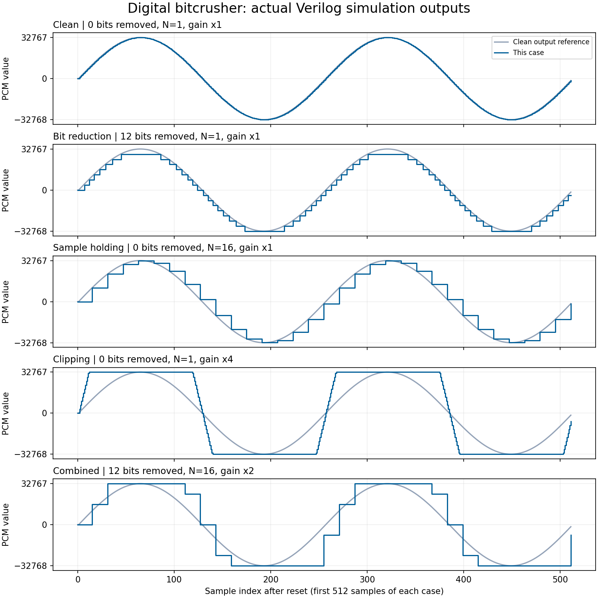

# Digital Audio Bitcrusher — Verilog Mini-Project

A simulation project for five members: change a stored digital waveform using
bit masking, a counter/register, and shift-and-clip logic. The aim is to explain
basic digital circuits through a visible audio effect.

**Scope:** fixed 16-bit signed samples, one 256-entry sine ROM, three controls,
five demonstration cases. No physical hardware is needed for this submission.

```text
ROM + counter -> bit mask -> sample-hold register -> gain + clipping -> output
   Member 1     Member 2          Member 3              Member 4
                     Member 5: connect and simulate
```

## Run it

Requires Icarus Verilog (`iverilog` and `vvp`); Python 3 is needed for automated
checks and optional WAV conversion. These tools were available during testing.

```bash
./run_sim.sh                 # Produce waveform and sample values
./run_tests.sh               # Check blocks, rerun demo, check every output sample
python3 convert_to_wav.py    # Optional: hear five 1-second cases
```

Open `bitcrusher.vcd` in a VCD waveform viewer. Under `bitcrusher_tb.dut`, add
`raw_sample_dbg`, `quantized_sample_dbg`, `held_sample_dbg`, `crushed_out`, and
`sample_en_dbg`. Display the sample buses as **signed decimal/analog** and zoom
into a few waveform periods. Each case has 32768 clocks, with reset between cases.

| Case | Bits removed | Hold N | Gain | What to show |
| --- | ---: | ---: | ---: | --- |
| Clean | 0 | 1 | 1× | Same sample values, with register latency |
| Bit reduction | 12 | 1 | 1× | Coarse amplitude steps, 4 effective bits |
| Sample holding | 0 | 16 | 1× | One value kept for 16 clocks |
| Clipping | 0 | 1 | 4× | Flat peaks at the signed limits |
| Combined | 12 | 16 | 2× | All three effects together |

The WAV uses 32768 samples/second, so the 256-sample ROM produces a 128 Hz tone.
The testbench's 20 ns clock only makes the simulation run in convenient units;
it does not represent the WAV playback rate. Start playback at low volume.



## Browser presentation demo

Open `viz/index.html` in your browser (on macOS: `open viz/index.html`). Click
**Start Audio & Oscilloscope** to hear the signal and see the input/output waves.
Use the sine source first, then demonstrate these settings one at a time:

1. Clean: bits removed 0, hold 1, gain 1×.
2. Bit reduction: bits removed 12, hold 1, gain 1×.
3. Sample holding: bits removed 0, hold 16, gain 1×.
4. Clipping: bits removed 0, hold 1, gain 4×.
5. Combined: bits removed 12, hold 16, gain 2×.

The synth, drum, and WAV-upload features are also preserved. The browser is the
interactive presentation aid; it runs a JavaScript model of the effect. Use
Verilog waveforms and tests to demonstrate circuit correctness. To hear the
actual Verilog output, play `bitcrusher_demo.wav` after running the conversion.

## What each member owns

| Member | File | Responsibility and viva topic |
| --- | --- | --- |
| 1 | `rtl/audio_source.v` | ROM, address counter, reset, wraparound; explain the sine table |
| 2 | `rtl/bit_depth_reducer.v` | AND mask, LSBs, two's complement; work positive/negative examples |
| 3 | `rtl/sample_rate_reducer.v` | Counter, register, clock enable; draw an N=4 timing table |
| 4 | `rtl/gain_clipper.v` | Shifts, sign extension, overflow, signed comparisons |
| 5 | `rtl/bitcrusher_top.v`, `tb/bitcrusher_tb.v` | Connections, testbench timing, waveform demonstration |

Member 2 has the shortest code, so also owns the block diagram and quantization
examples. Everyone should understand the whole signal path and test their own
block; the split is by responsibility, not equal line counts.

## Files to study

- `rtl/`: five short design modules, all with fixed widths.
- `tb/bitcrusher_tb.v`: the presentation testbench.
- `sine_rom.mem`: the one shared ROM table; `gen_sine_table.py` regenerates it.
- [Study and viva guide](docs/STUDY_GUIDE.md): concepts, examples, questions, demo script.
- [Scope review](docs/SCOPE_REVIEW.md): what was kept, simplified, and corrected.
- `tests/`: extra automated checks; not another project feature to present.
- `viz/index.html`: browser demo for live audio and waveform presentation.
- `audio/`, `generate_sample_audio.py`: example audio and its generator.
- `Report_Word_Template.docx`: existing user-provided template, left untouched.

## Limits to state honestly

This is a simulated digital datapath, not a microphone-to-speaker system. It
uses a ROM instead of an ADC and does not implement a DAC, audio codec, FPGA
board interface, filters, FFT, or a processor. Sample holding deliberately
introduces distortion; it is not a high-quality sample-rate converter. The RTL
has not been synthesized or tested on a board; ROM initialization support
would depend on the target tools.
